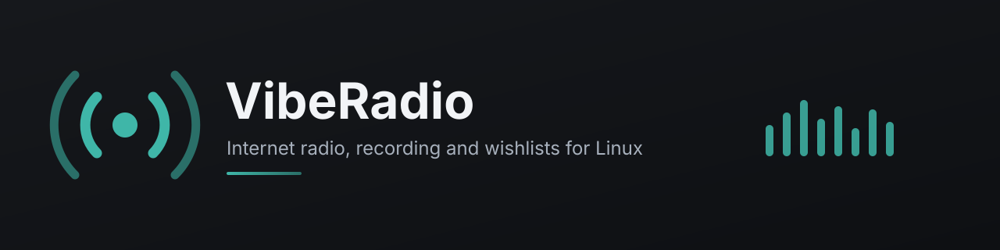
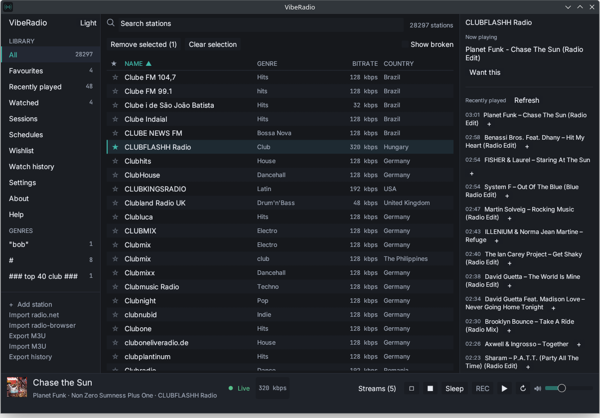
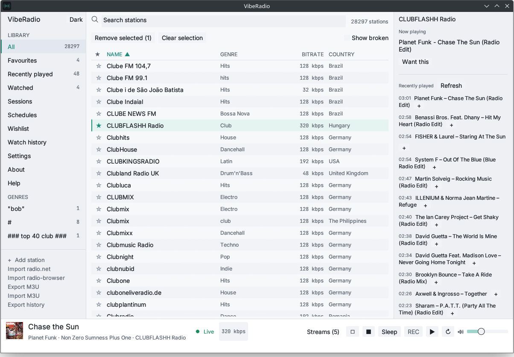

<p align="center">
  
</p>

<p align="center">
  
  
  
  
  
  <a href="https://ko-fi.com/gishi"></a>
</p>

<p align="center">
  <a href="https://github.com/Gishi1/viberadio">GitHub</a> ·
  <a href="https://gitlab.com/Gishi1/viberadio">GitLab</a>
</p>

**VibeRadio** is a native internet-radio client for Linux, written in Rust with
[egui](https://github.com/emilk/egui). It plays radio, keeps a searchable
library, records songs as separate files, identifies them with Chromaprint and
AcoustID, builds a clean `verified/` music tree, and watches stations for songs
on your wishlist.

There is no WebView, no Electron layer, no account and no telemetry. Everything
lives in a local SQLite database and a recordings folder.

<p align="center">
  
</p>
<p align="center"><sub>Dark theme</sub></p>

<p align="center">
  
</p>
<p align="center"><sub>Light theme</sub></p>

## Features

### Listening
- Import stations from **radio.net** and **radio-browser**, or add a stream by URL.
- Search, filter by genre, sort by name, genre, bitrate or country.
- Favorites, sessions, scheduled stations and a compact mini player.
- Multiple streams at once, each with its own volume, plus a tray icon and
  MPRIS media-key support on Linux.
- ICY metadata in the stream bar, with artwork and album details from the
  iTunes Search API.
- HLS (`.m3u8`) streams, including live playlists with AAC, MP3, MPEG-TS or
  fragmented MP4 segments.
- MP3, AAC-LC, Ogg Vorbis, Ogg Opus, FLAC and WAV playback.

### Recording
- Split recordings into one file per song, with a filename template.
- Close a file on the station's next title, on the catalog duration, or on a
  live fade/silence/hard-drop boundary.
- Background recording uses its own record-only stream, so playback and
  recording are independent.
- Optional wishlist-only mode keeps only the songs you asked for.
- A disk-space guard stops recording before the drive fills.
- Short fragments are removed before fingerprinting.

### Verified library
- Fingerprint every finished recording locally with Chromaprint.
- Identify songs with AcoustID when an application key is configured.
- Copy the best complete airing into `verified/<artist>/<album>/`, tag it with
  ID3 (artist, title, album, year) and embed the Cover Art Archive front cover.
- Keep the best airing per AcoustID recording and discard duplicates.

### Wishes and watched stations
- Wishlist rules for **record**, **activate**, **record + activate** and
  **ignore**, with exact, contains or starts-with matching.
- Live matching as ICY titles arrive, before the song ends.
- Mark stations as **watched**; each keeps a background stream and a rolling
  audio buffer, so a wish is recorded from the song's title mark rather than
  from the moment the match was noticed.
- **Watch history** lists songs heard on watched stations and adds any of them
  as a wish in one click.
- Wishlist search plus JSON import/export.

### Library hygiene
- Stations that fail to play repeatedly are marked broken and hidden, with a
  **Show broken** toggle and bulk removal.
- Multi-select rows with Ctrl/Cmd-click and Shift-click for bulk actions.
- One-time bitrate probing for directories that do not publish a bitrate.
- Automatic database migrations, with a backup before upgrading.

## Install

### Flatpak

The Flatpak manifest lives in [`flatpak/`](flatpak). With `flatpak-builder`
installed:

```bash
flatpak-builder --user --install --force-clean build-dir \
  flatpak/io.github.gishi1.VibeRadio.yml
flatpak run io.github.gishi1.VibeRadio
```

The manifest builds offline from the vendored `flatpak/cargo-sources.json` and
installs the desktop entry, AppStream metadata and icon.

### Linux tarball

Download `viberadio-<version>-linux-x86_64.tar.gz` from the releases page,
extract it and run the binary:

```bash
tar xzf viberadio-0.1.0-linux-x86_64.tar.gz
./viberadio-0.1.0-linux-x86_64/viberadio
```

The tarball contains the binary, desktop file, icon, AppStream metadata and
license.

### AppImage

Download `viberadio-<version>-linux-x86_64.AppImage`, make it executable and
run it:

```bash
chmod +x viberadio-0.1.0-linux-x86_64.AppImage
./viberadio-0.1.0-linux-x86_64.AppImage
```

The AppImage bundles the shared libraries it needs. It still requires FUSE; on
a distribution without it, install `libfuse2` or run with
`--appimage-extract-and-run`.

### macOS

Download `viberadio-<version>-macos-aarch64.tar.gz` for Apple Silicon or
`viberadio-<version>-macos-x86_64.tar.gz` for Intel, extract it and run the
binary:

```bash
tar xzf viberadio-0.1.0-macos-aarch64.tar.gz
./viberadio-0.1.0-macos-aarch64/viberadio
```

The build is unsigned, so macOS may refuse to open it. Allow it once under
**System Settings → Privacy & Security → Open Anyway**, or clear the quarantine
flag:

```bash
xattr -d com.apple.quarantine viberadio-0.1.0-macos-aarch64/viberadio
```

### Windows

Download `viberadio-<version>-windows-x86_64.zip`, extract it and run
`viberadio.exe`. SmartScreen may warn about an unsigned executable; choose
**More info → Run anyway**.

### Build from source

VibeRadio needs Rust 1.86 or newer, a C toolchain, `pkg-config` and ALSA
development headers. On Debian/Ubuntu:

```bash
sudo apt install build-essential pkg-config libasound2-dev \
  libxkbcommon-dev libwayland-dev libx11-dev libgl1-mesa-dev
cargo build --release
./target/release/viberadio
```

With Nix, the included flake provides the same toolchain:

```bash
nix develop
cargo build --release
```

Or with the classic shell:

```bash
nix-shell --run "cargo build --release"
```

## First run

1. Open **Import radio.net** or **Import radio-browser** in the sidebar. Nothing
   is imported automatically.
2. Select a station and press Play, or double-click a row.
3. Open **Settings** to choose the recording folder, filename template, split
   mode, minimum length, disk-space floor and an optional AcoustID application
   key.
4. Add rules in **Wishlist**, or right-click a station and choose **Watch for
   wishes** to keep a background buffer and collect its history.

The data directory is `~/.local/share/VibeRadio/` on Linux and contains
`viberadio.db`, `recordings/` and `verified/`.

## AcoustID

Local Chromaprint fingerprints are always written next to a recording as
`<file>.fingerprint.json`. Identification, canonical duration, deduplication and
the `verified/` tree need a free **application** key from
[acoustid.org/new-application](https://acoustid.org/new-application). A personal
user key is not accepted by the lookup API. Without a key, fingerprints are
still stored and can be identified later.

## Development

```bash
cargo test          # offline suite; live-network tests are ignored
cargo build         # debug binary
cargo build --release
```

The test suite covers the ICY demuxer, stream boundaries, recording splits,
fingerprinting, database migrations, imports, scheduling, the wishlist matcher,
the watch buffer and the catalog matcher. Live-station tests are marked
`#[ignore]` and need outbound network.

Design notes and the release checklist live in [`docs/`](docs). The release
checklist is [`docs/RELEASE.md`](docs/RELEASE.md).

## Releases

`scripts/release.sh` builds a Linux release, packages a tarball and checksums,
and can tag the commit. Pushing a `v*` tag runs the packaging scripts for
Linux, Windows and macOS on GitHub Actions and attaches every archive to the
release; GitLab builds the Linux artifact. See
[`docs/RELEASE.md`](docs/RELEASE.md) for the full checklist.

## Limitations

- Linux is the tested target. CI also produces Windows x86_64 and macOS
  (Apple Silicon and Intel) builds, but they have not been run on real hardware
  yet; bug reports are welcome.
- Windows and macOS audio output is unverified. Hosted CI runners expose an
  output device that never consumes samples, so the playback tests are skipped
  there.
- HLS is supported for raw AAC/MP3, MPEG-TS and fragmented MP4 segments.
  Encrypted playlists (`EXT-X-KEY`) are rejected.
- AAC-LC and Ogg Opus are supported; HE-AAC (SBR) is not decoded.
- AcoustID identification needs an application key.
- The `verified/` tree selects the best complete airing; it does not stitch a
  missing intro or outro from several airings yet.

## Support

VibeRadio is free and open source. If it is useful to you, you can support
development on [Ko-fi](https://ko-fi.com/gishi).

## License

VibeRadio is released under the [MIT License](LICENSE).
